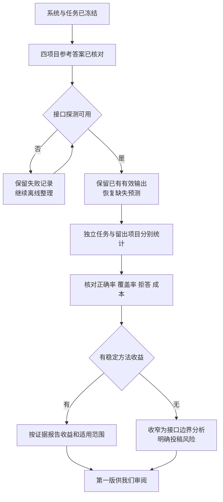

# 我们现在有多少证据

这是实验检查点。第一版正文已经形成。独立预测和留出项目预测尚未完成。当前还不能按“我们的方法更准、更省”投稿。

| 我们要证明什么 | 已有证据 | 当前判断 |
|---|---|---|
| 目录内请求能正确查询 | 144条开发请求：强直接查询143条正确，服务144条正确 | 有基础能力；1条差距不足以证明优势 |
| 明确拒答规则有用 | 两项目12条目录外任务：安全拒答从2条变为12条 | 支持这组开发题的协议改进；拒答不是完成任务 |
| 返回事件细节有用 | 扩展服务在24条可回答开发题中完成22条；强直接查询也完成22条 | 补上已知能力缺口；没有总体正确率优势 |
| 少给信息会丢失答案 | 两个构造图的旧服务观察相同，窗口计数分别为1和0 | 支持这个接口的具体信息缺口；不是新的通用理论 |
| 能处理目录外新任务 | 8个来源目标和3个合成可回答目标都超出当前目录 | 有覆盖缺口；不能只报目录内正确率 |
| 能迁移到新项目 | IoTDB、Elasticsearch已导入；参考查询已核对 | 数据准备完成；模型成绩待测 |
| 总成本更低 | 全上下文Redis仅少551 tokens；紧凑上下文存在缺失用量 | 尚未证明 |

## 我们准备好的新任务

| 任务组 | 独立目标定义数 | 每项目表述数 | 用途 |
|---|---:|---:|---|
| 来源任务的快照版本 | 8 | 8 | 查服务覆盖了什么 |
| 合成可回答任务 | 3 | 6 | 查新查询和成对表述 |
| 方向诊断 | 1 | 1 | 查是否擅自反转关系；单独报告 |
| 缺证据请求 | 6 | 6 | 查是否正确拒答 |

每项目21条。四项目绑定后是84条实例，不是84个独立目标。来源目标是经过限定的快照版本，不冒充原始CHAOSS或RepoQA任务。AI角色不计作人类用户。缺失、歧义和不支持的生成结果全部保留。

来源任务的32个“目标×项目”参考检查全部通过。合成任务28个表述检查全部通过，实际对应16个“目标×项目”组合。这些是CSV与独立Cypher的答案核对，不是模型准确率。

## 当前阻塞

模型接口不稳定。最近来源批次8次调用有5次基础设施失败，已停止。G只评估了3条，P评估了2条，I评估了3条。不能写成每个方法都完成了8条并且全错。

新调用总账当前214次，上限1200次。36次缺用量；已知用量合计1,007,474 tokens。未知用量不等于零费用。没有核实单价，暂不报货币成本。原先E1/E3调用单独留档，不在这214次内。

## 我们接下来只补这些

| 工作 | 怎么做 | 完成条件 |
|---|---|---|
| 恢复预测 | 后续只做有记录的低频探测；可用后单独恢复批次 | 保留原失败，保留已有有效输出；连续3次失败即停 |
| 完成独立任务 | 固定模型、目录、题目、评分；跑G/P/I | 各任务组分别有完整结果和失败分母 |
| 完成两个留出项目 | 同一套任务规则绑定两个已选项目 | 不按成绩换项目，不按新题改服务 |
| 完成成本分析 | 汇总所有尝试、修复、失败和未知用量 | 不重复收费，不只统计成功调用 |
| 收口第一版 | 把实际结果填进现有正文 | 主张与证据一一对应；不自动投稿 |

我们不会为了让服务赢而新增题目或补目录。当前的核心投稿风险是：小目录覆盖有限本身不够新。独立结果需要给出可操作的边界结论，才能使论文有更强的贡献。第一版已经把这个风险写清楚，没有把未完成实验写成成功结果。
